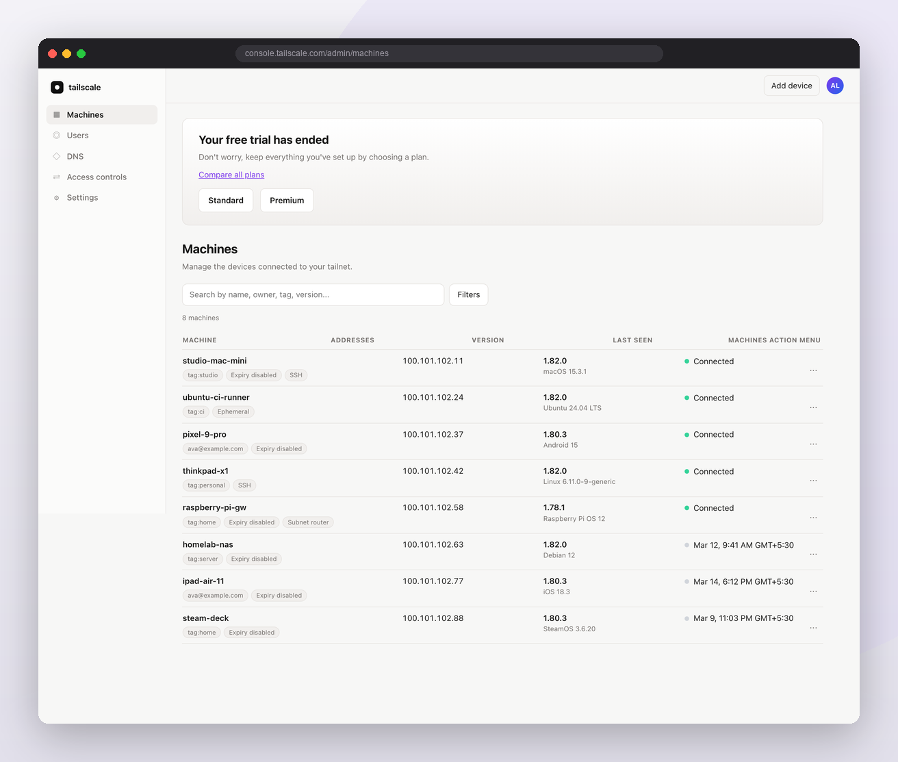
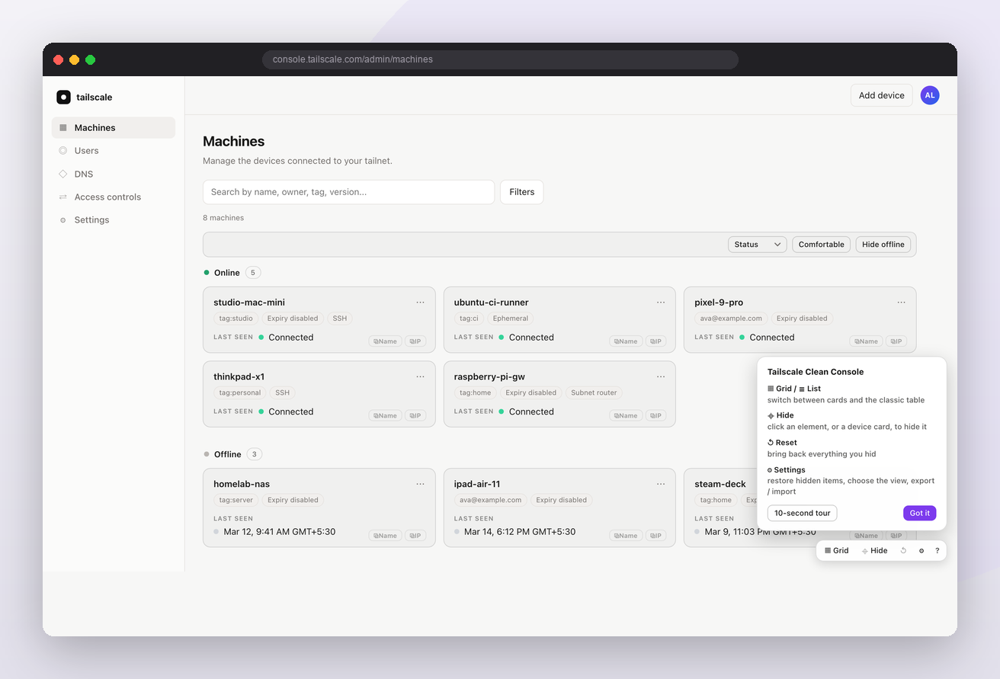

#  Tailscale Clean Console

A tiny browser extension that cleans up the Tailscale admin console. It hides
the "Your free trial has ended" banner, shows your machines as an **Online /
Offline** card grid, and lets you hide anything else with one-click reset.

Live on Firefox Add-ons:
<https://addons.mozilla.org/en-US/firefox/addon/tailscale-clean-console/>

| Before | After |
| --- | --- |
|  |  |

## Install

- **Firefox (MV2)** — [install from Firefox Add-ons](https://addons.mozilla.org/en-US/firefox/addon/tailscale-clean-console/),
  or load `firefox/manifest.json` at `about:debugging#/runtime/this-firefox` →
  **Load Temporary Add-on…** (gone after restart; keep it with
  `npx web-ext sign --source-dir firefox --channel unlisted`).
- **Chrome / Edge (MV3)** — open `chrome://extensions`, turn on *Developer
  mode*, click **Load unpacked**, and pick the `chrome/` folder.

## Usage

A pill sits in the bottom-right of the Machines page:

| Button | Action |
| --- | --- |
| ▦ Grid / ☰ List | toggle card grid ↔ classic table |
| ⌖ Hide | hide an element, or a whole device (Esc cancels) |
| ↺ | show everything you hid |
| ? | reopen the help card |

On your first visit a short welcome card explains the buttons, with an optional
10-second tour. Dismiss it with **Got it**; the `?` brings it back any time.
Hiding a device drops its card from the **Online / Offline** totals — reset
brings everything back.

Your layout and hidden items are saved per-site in `localStorage`
(`tsc:settings:v1`) and never leave your browser. See [PRIVACY.md](PRIVACY.md).

## Develop

`chrome/` and `firefox/` are the two builds (Manifest V3 / V2), kept
byte-identical; `test/` holds a mock Machines page and the assertion harness;
`assets/` has the store zips, icons, screenshots and listing copy.

```sh
node test/serve.mjs           # then open http://localhost:8787/test/harness.html (?ext=chrome|firefox)
python3 test/run_harness.py   # headless run of both builds (needs: pip install playwright && playwright install chromium)
```

CI runs the harness for both builds, `web-ext lint` on Firefox, and the privacy
/ parity checks; `v*` tags publish the store zips to a GitHub release. See
[ROADMAP.md](ROADMAP.md) for planned work.

Unofficial project, not affiliated with Tailscale Inc. See
[PRIVACY.md](PRIVACY.md).

---

<a href="https://sensescape.in/"></a>
